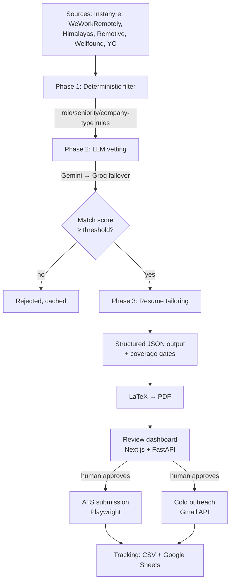

# Job Application Agent

An autonomous, human-in-the-loop agent that finds relevant engineering roles, screens them
against a candidate profile, generates a tailored resume for each one, and submits or drafts
outreach — with a review dashboard so a human approves anything irreversible.

Built as an exercise in **practical LLM application engineering**: multi-provider orchestration
with failover, schema-constrained generation, anti-hallucination guardrails, and deterministic
gates around a non-deterministic core.

---

## Why it exists

Job hunting is a high-volume, low-signal pipeline. Most of the work — reading job descriptions,
judging fit, rewriting the same resume for the hundredth time — is mechanical. The parts that
actually matter (deciding to apply, talking to people) are not.

This system automates the mechanical stages and deliberately stops at the ones that aren't.

---

## Architecture



Each phase writes artifacts to disk, so any stage can be re-run or inspected independently
without repeating the ones before it.

---

## Engineering notes

**Provider failover.** LLM calls route through a provider abstraction (`ai_providers.py`) that
falls back from Google Gemini to Groq on rate limits, timeouts and malformed responses. A single
provider outage degrades throughput rather than stopping the pipeline.

**Schema-constrained generation.** Resume tailoring (`ai_engine.py`) requires strict JSON matching
a known schema. Responses are parsed and validated before use; a malformed response is retried
against the fallback provider rather than being silently accepted.

**Anti-hallucination guardrails.** The tailoring prompt forbids inventing companies, dates, degrees
and metrics. Where a job description asks for a technology the candidate lacks, the model is
instructed to surface it in the skills section and use truthful adjacent evidence in bullets rather
than fabricating direct experience. Every claim is required to be interview-defensible.

**Coverage gates.** Generated resumes are checked against the mandatory themes extracted from the
job description. A resume that fails coverage is regenerated rather than shipped.

**Deterministic pre-filter.** Cheap rule-based filtering (`phase_runner.py`) removes management
roles, staffing firms and out-of-band seniority before any tokens are spent, so LLM cost scales
with plausible candidates rather than raw scrape volume.

**Human-in-the-loop by design.** Nothing irreversible — no submission, no email — happens without
explicit approval through the dashboard. The agent proposes; the human disposes.

---

## Stack

| Layer | Technology |
|---|---|
| Orchestration | Python 3.9+, asyncio |
| LLMs | Google Gemini, Groq (with failover) |
| API | FastAPI |
| Dashboard | Next.js, React, TypeScript |
| Scraping | Playwright, BeautifulSoup, httpx |
| Documents | LaTeX → PDF |
| Delivery | Gmail API (OAuth2), Playwright ATS automation |
| Tracking | CSV, Google Sheets API |
| Testing | pytest |

---

## Getting started

```bash
git clone https://github.com/pseudog0d/job-apply-agent.git
cd job-apply-agent

python3 -m venv .venv && source .venv/bin/activate
pip install -r requirements.txt
playwright install chromium

cp .env.example .env                  # add your API keys
cp profile.example.json profile.json  # add your candidate details
```

Both `.env` and `profile.json` are gitignored — no personal data or credentials are committed.

### Running

```bash
python main.py scrape-only --max 100   # gather jobs into CSV, no LLM calls, no sending
python main.py vet-only --max 100      # + LLM screening and match scoring
python main.py phase3 --job-id <id>    # generate tailored resume for one role
python main.py run --dry-run           # full pipeline, nothing sent
```

`scrape-only` and `--dry-run` never send email or submit applications — useful for evaluating
the pipeline safely.

### Dashboard

```bash
uvicorn dashboard_api.app:app --port 8008    # API
cd review-ui && npm install && npm run dev   # UI
```

### Tests

```bash
pytest
```

---

## Project layout

```
ai_engine.py          Resume tailoring: prompt construction, schema validation, coverage gates
ai_providers.py       LLM provider abstraction with automatic failover
job_vetter.py         LLM pre-screening and match scoring
scraper.py            Multi-source job scraping
phase_runner.py       Phase orchestration and deterministic filtering
pdf_generator.py      LaTeX resume rendering
applier.py            Playwright-driven ATS submission
email_finder.py       Contact discovery waterfall (Hunter → Apollo → Snov → Serper)
gmail_sender.py       Gmail API sending with rate limiting and follow-ups
tracker.py            Application tracking (CSV + Google Sheets)
artifact_store.py     Per-application artifact persistence
dashboard_api/        FastAPI backend for the review dashboard
review-ui/            Next.js review dashboard
tests/                pytest suite
```

---

## Notes and limitations

- Scrapers depend on third-party page structure and will need maintenance as sites change.
- Respect each platform's terms of service. Several job boards prohibit automated access;
  the deterministic and LLM stages are useful independently of any automated submission.
- Generated resume content is a draft. Review it before it goes anywhere — the guardrails
  reduce hallucination, they don't eliminate the need for a human to read the output.

## License

MIT
